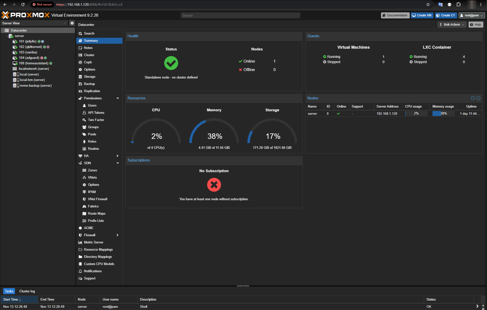
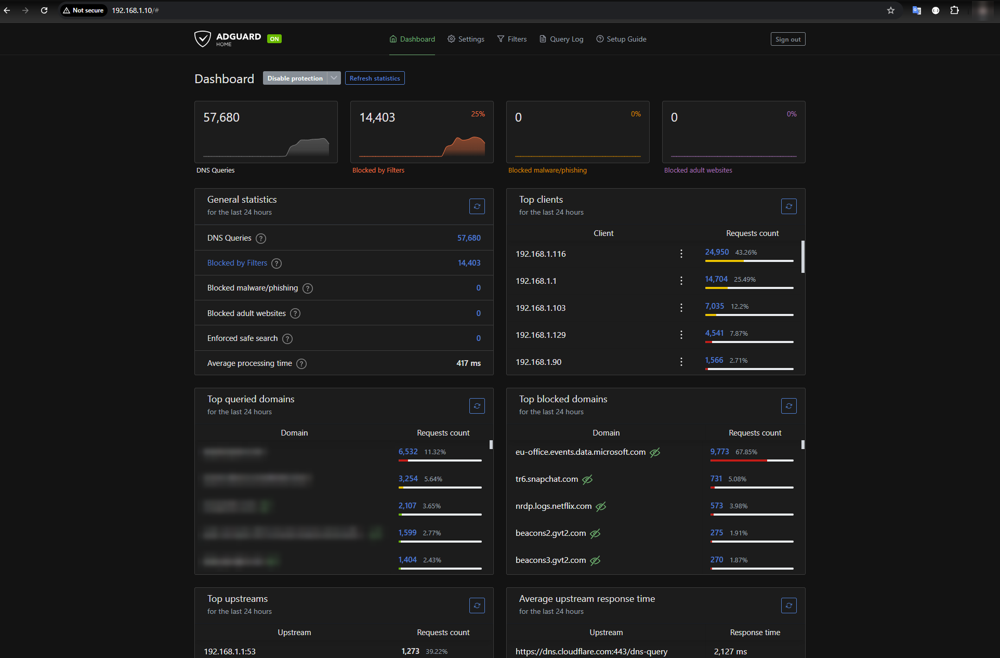
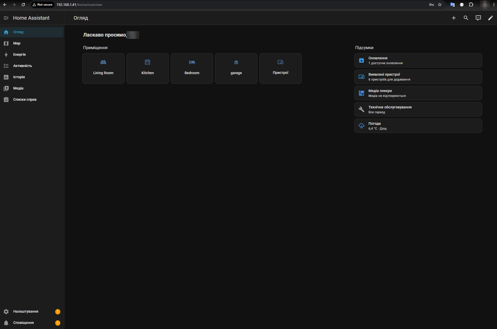
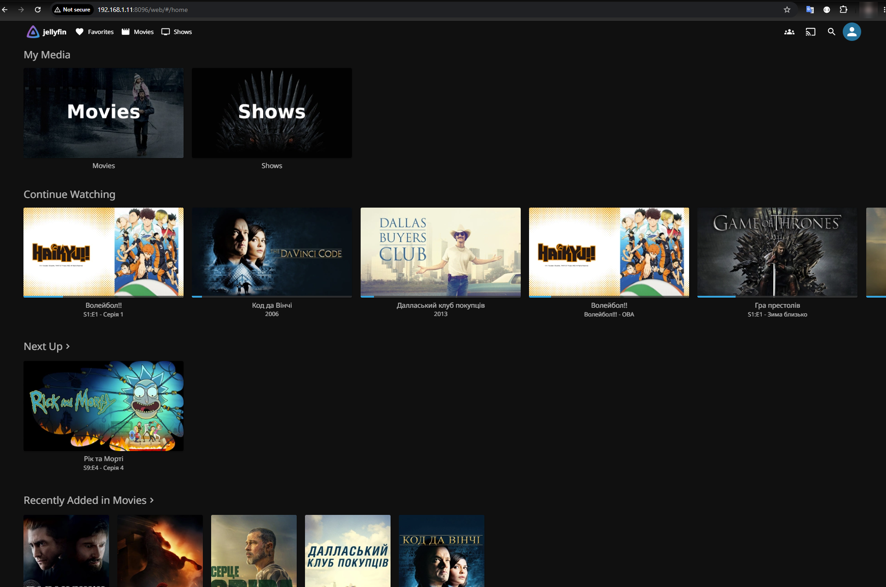
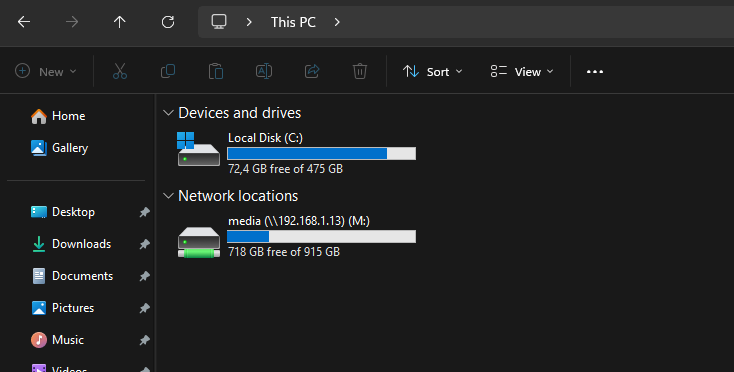
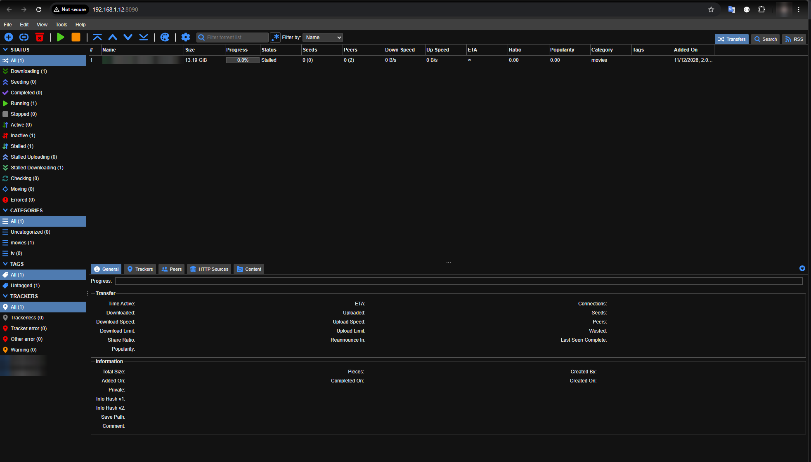
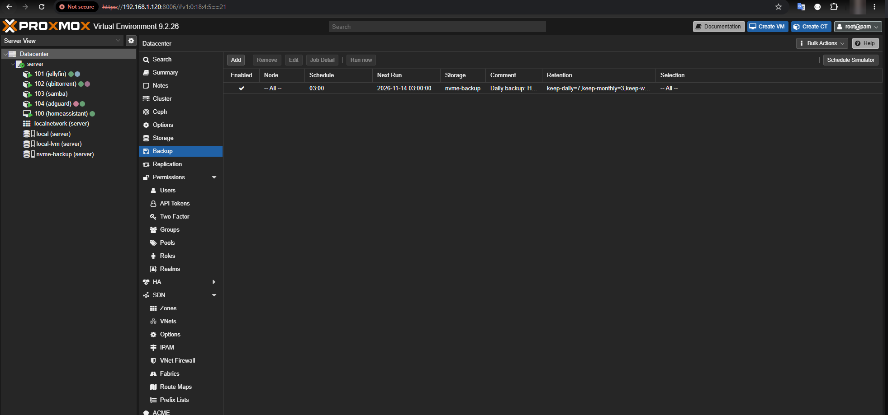

# Home Server — Proxmox VE Homelab

**English** | [Українська](README.uk.md)

A small home server on **Proxmox VE**. It provides media streaming, file sharing, torrent downloads, network-wide ad blocking, and home automation.

> Status: in production · Updated: 2026-11-12 · This is a living document; new services will be added (see [Roadmap](#7-roadmap)).

## 1. Hardware and network

| Component | Value |
|---|---|
| Server | HP EliteDesk 800 G2 Mini: i5-6500T (Skylake, HD 530), 12 GB RAM |
| Disks | 128 GB SATA SSD for the system and VM/CT disks; 1 TB NVMe for media and backups |
| Hypervisor | Proxmox VE 9.2 (Debian 13), `no-subscription` repo |
| Router | Keenetic Hero, LAN `192.168.1.0/24`, domain `zelena.home`, WAN PPPoE behind CGNAT, WAN IPv6 off |
| Clients | Windows PC, Samsung QE65QN85D TV (wired) |

DHCP hands out `192.168.1.33–152`. Servers use static addresses below `.33`. All DNS goes through AdGuard: DHCP DNS points to `.10`, Keenetic itself forwards to `.10` (global `ip name-server`, "Ignore DNSv4 from ISP"). The old built-in Keenetic apps (DLNA, Transmission, SMB) are disabled.



## 2. Services and addresses

| ID | Service | IP | Access | vCPU / RAM / Disk | Boot order |
|---|---|---|---|---|---|
| — | Proxmox host | 192.168.1.120 | https://192.168.1.120:8006 | — | — |
| CT 104 | AdGuard Home | 192.168.1.10 | http://192.168.1.10 | 1 / 512 MB / 4 GB | 1 |
| VM 100 | Home Assistant OS | 192.168.1.41 | http://192.168.1.41:8123 | 2 / 4 GB / 32 GB | 2 |
| CT 101 | Jellyfin | 192.168.1.11 | http://192.168.1.11:8096 | 4 / 2 GB / 16 GB | 3 |
| CT 103 | Samba | 192.168.1.13 | `\\192.168.1.13\media` | 1 / 512 MB / 4 GB | 4 |
| CT 102 | qBittorrent | 192.168.1.12 | http://192.168.1.12:8090 | 2 / 1 GB / 4 GB | 5 |

All containers are **unprivileged LXC** and all guests start on boot. AdGuard starts first so DNS is ready for the others.

**AdGuard Home.** Network-wide DNS with ad/tracker blocking. Upstreams are Cloudflare and Quad9 over DoH. Local names (`zelena.home`) and reverse lookups go to the router. Blocklists: AdGuard DNS filter + HaGeZi Multi NORMAL.


**Home Assistant OS.** The home automation hub, running as a full VM. It is reserved for future camera and intercom integration.


**Jellyfin.** The media server, with Intel Quick Sync passed through (`/dev/dri`). Libraries are `/media/movies` and `/media/tv`, with real-time monitoring. Verified: 4K HDR10 **Direct Play** on the TV, and Dolby Vision 8.1 plays as HDR10.


**Samba.** SMB2+ file server. Shares: `media` (read/write) and `backups` (read-only), user `media`. NetBIOS is off, so map it by IP (`net use M: \\192.168.1.13\media /persistent:yes` from a non-admin shell).


**qBittorrent.** Torrent client (Web UI). Listening port 52624, UPnP off. Categories `movies` and `tv` save straight into the Jellyfin libraries; unfinished files go to `downloads/incomplete`.


## 3. Storage and permissions

```
/mnt/nvme-pool/                (NVMe, ext4, noatime,nofail)
├── media/        → /media in CT 101, 102, 103
│   ├── movies/   tv/   downloads/{incomplete,complete}
└── backups/      → Proxmox storage "nvme-backup"; /backups (ro) in CT 103
```

The system SSD holds `local-lvm` (LVM-thin, ~67 GB) for guest disks.

Unprivileged containers map UID 1000 to host UID 101000. The media tree is `101000:101000`, mode `775`. Every service writes as `media` (qBittorrent via a systemd override with `UMask=0002`, Samba via `force user`, Jellyfin as a group member), so all services can read and write each other's files.

Naming for Jellyfin: `tv/Show (Year)/Season 01/Show S01E01.mkv`, `movies/Movie (Year)/Movie (Year).mkv`.

## 4. Backups

| What | Schedule | Retention |
|---|---|---|
| All VMs/CTs (vzdump, snapshot, zstd) → `nvme-backup` | daily 03:00 | 7 daily / 4 weekly / 3 monthly |
| Host config (`/etc/pve`, network, fstab, …) tar.gz | weekly | 60 days |

Media is not backed up because it can be re-downloaded.



## 5. Potential issues

- **Single NVMe, no redundancy.** Media and backups share one disk; if it fails, both are gone. Copy `backups/` off the server regularly.
- **NVMe not mounted.** Because of `nofail`, the host still boots, but the containers see an empty `/media` and backups fail. Check `mountpoint /mnt/nvme-pool`.
- **DNS single point of failure.** If CT 104 is down, the LAN has no DNS. Rollback on Keenetic: `no ip name-server 192.168.1.10`, set DHCP DNS back to the router. Re-enabling WAN IPv6 lets clients bypass AdGuard.
- **Transcoding limits (Skylake).** There is no hardware decoding for HEVC 10-bit or AV1. 4K HDR transcoding falls back to the CPU and stutters, so keep to Direct Play. Image subtitles (PGS) force transcoding; prefer SRT.
- **Dolby Vision profile 5.** Samsung does not support DV, and P5 has no HDR10 fallback, so colours come out wrong. Avoid these releases.
- **Wi‑Fi** is often too slow for 4K remuxes; use cable.
- **CGNAT.** No inbound torrent connections, so downloads are slower, and no direct remote access. Torrent traffic is not behind a VPN.
- **Home Assistant IP from the DHCP pool.** `192.168.1.41` is inside the pool, so pin it in Keenetic (permanent IP) or the address may change.
- **Small system SSD.** LVM-thin can be over-committed; check `lvs` before adding guests.
- **Updates** may change the iGPU group IDs (`render`/`video`) and break Jellyfin hardware acceleration. Back up before `apt full-upgrade`.
- **Security.** Do not port-forward Proxmox, Samba, or qBittorrent. Never commit passwords to this repository.

## 6. Clients

| Client | Connection |
|---|---|
| Windows | `M:` → `\\192.168.1.13\media`, browser → Jellyfin |
| Samsung TV | Jellyfin app → `http://192.168.1.11:8096`, wired |

## 7. Roadmap

| Planned | Notes |
|---|---|
| Remote access from phone | CGNAT rules out port forwarding, so use an overlay VPN (e.g. Tailscale) in a small LXC |
| Photo storage | Self-hosted photo backup (e.g. Immich) on the NVMe, with its own backup copy |
| Cameras / intercom | Hikvision + Dahua cameras and the intercom via Home Assistant |
| Offsite backups | Automatic copy of `backups/` to an external disk or the cloud |

## Changelog

| Date | Change |
|---|---|
| 2026-11 | Initial setup: Proxmox, AdGuard, HAOS, Jellyfin, Samba, qBittorrent, backups |
| 2026-11-13 | Screenshots added |
