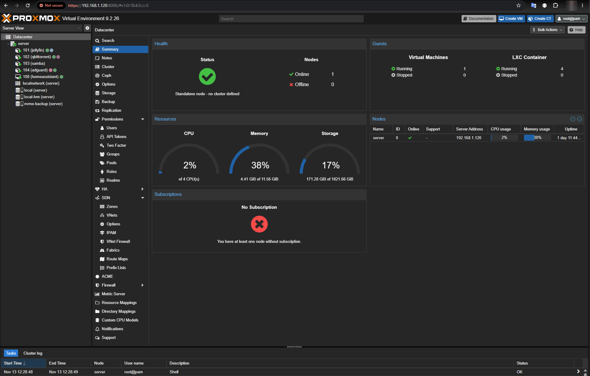
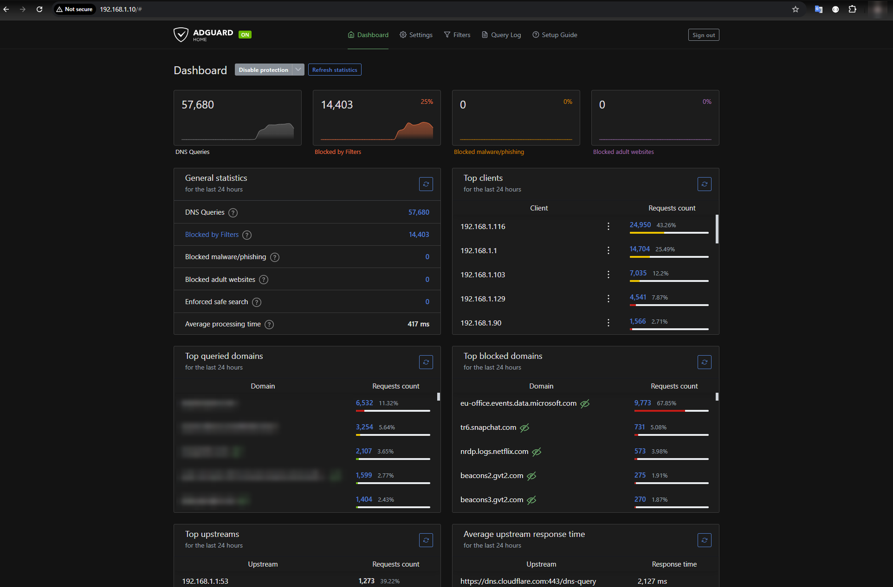
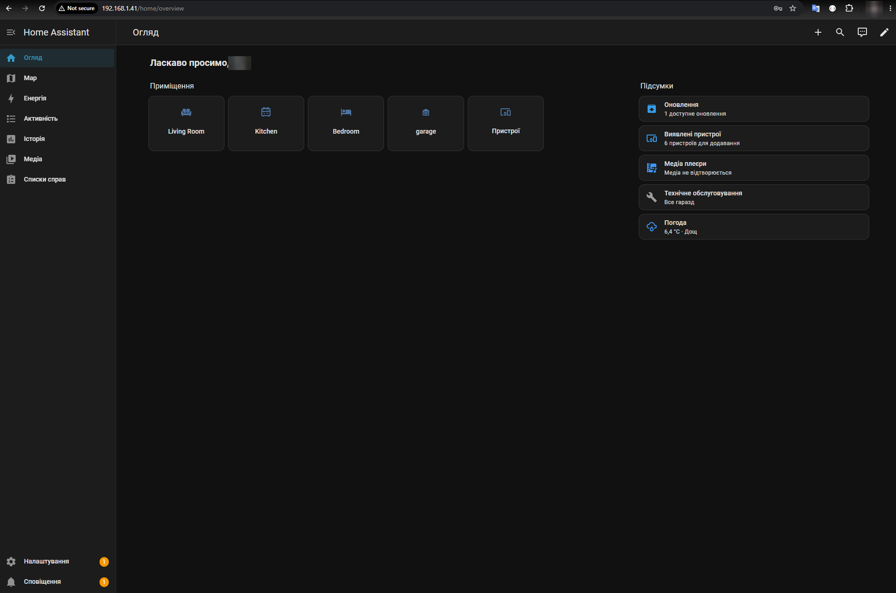
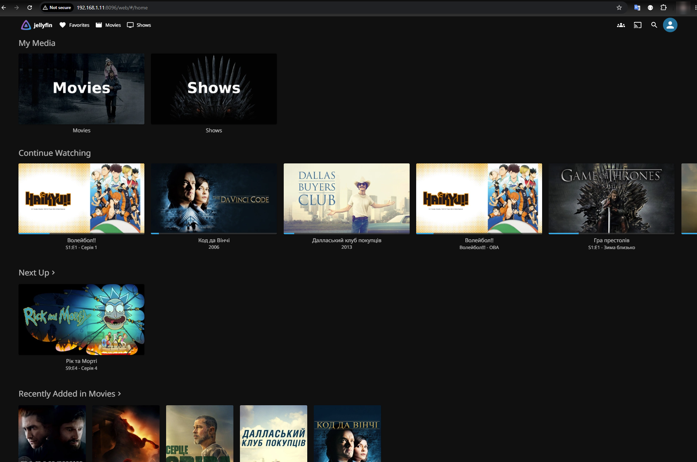
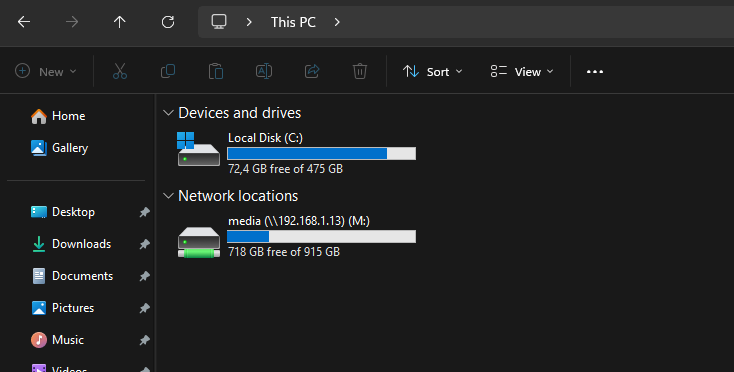
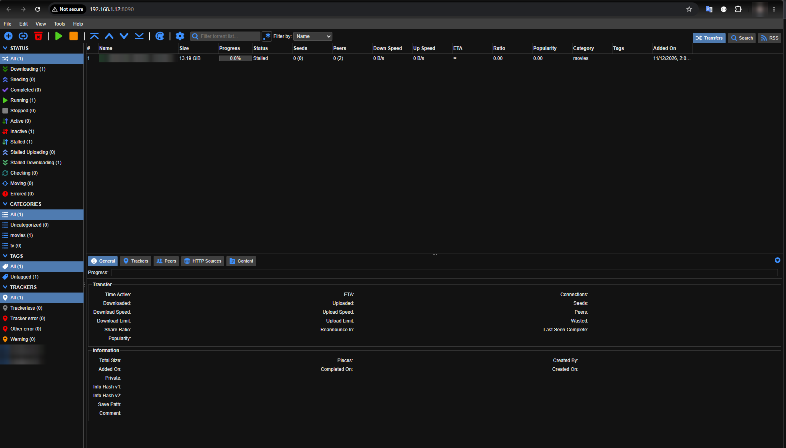
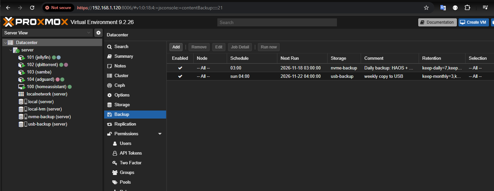

# Домашній сервер — Proxmox VE Homelab

[English](README.md) | **Українська**

Невеликий домашній сервер на **Proxmox VE**. На ньому працюють стрімінг медіа, файловий доступ, торенти, блокування реклами для всієї мережі та домашня автоматизація.

> Статус: у роботі · Оновлено: 2026-11-12 · Документ доповнюватиметься новими сервісами (див. [План розвитку](#7-план-розвитку)).

## 1. Обладнання та мережа

| Компонент | Значення |
|---|---|
| Сервер | HP EliteDesk 800 G2 Mini: i5-6500T (Skylake, HD 530), 12 ГБ RAM |
| Диски | 128 ГБ SATA SSD для системи та дисків VM/CT; 1 ТБ NVMe для медіа та бекапів |
| Гіпервізор | Proxmox VE 9.2 (Debian 13), репозиторій `no-subscription` |
| Роутер | Keenetic Hero, LAN `192.168.1.0/24`, домен `zelena.home`, WAN PPPoE за CGNAT, IPv6 на WAN вимкнено |
| Клієнти | ПК з Windows, телевізор Samsung QE65QN85D (кабель) |

DHCP роздає адреси `192.168.1.33–152`. Сервери мають статичні адреси нижче `.33`. Увесь DNS іде через AdGuard: у DHCP вказано DNS `.10`, і сам Keenetic теж пересилає запити на `.10` (глобальний `ip name-server`, «Ignore DNSv4 from ISP»). Старі вбудовані застосунки Keenetic (DLNA, Transmission, SMB) вимкнено.



## 2. Сервіси та адреси

| ID | Сервіс | IP | Доступ | vCPU / RAM / Диск | Порядок запуску |
|---|---|---|---|---|---|
| — | Хост Proxmox | 192.168.1.120 | https://192.168.1.120:8006 | — | — |
| CT 104 | AdGuard Home | 192.168.1.10 | http://192.168.1.10 | 1 / 512 МБ / 4 ГБ | 1 |
| VM 100 | Home Assistant OS | 192.168.1.41 | http://192.168.1.41:8123 | 2 / 4 ГБ / 32 ГБ | 2 |
| CT 101 | Jellyfin | 192.168.1.11 | http://192.168.1.11:8096 | 4 / 2 ГБ / 16 ГБ | 3 |
| CT 103 | Samba | 192.168.1.13 | `\\192.168.1.13\media` | 1 / 512 МБ / 4 ГБ | 4 |
| CT 102 | qBittorrent | 192.168.1.12 | http://192.168.1.12:8090 | 2 / 1 ГБ / 4 ГБ | 5 |

Усі контейнери — **непривілейовані LXC**. Усі гості запускаються разом із сервером. AdGuard стартує першим, щоб DNS був доступний решті сервісів.

**AdGuard Home** — DNS для всієї мережі з блокуванням реклами та трекерів. Upstream-сервери: Cloudflare і Quad9 через DoH. Локальні імена (`zelena.home`) і зворотні запити (PTR) він передає роутеру. Списки блокування: AdGuard DNS filter і HaGeZi Multi NORMAL.


**Home Assistant OS** — центр домашньої автоматизації, працює як повноцінна VM. Згодом сюди підключимо камери й домофон.


**Jellyfin** — медіасервер. У контейнер прокинуто Intel Quick Sync (`/dev/dri`). Бібліотеки: `/media/movies` і `/media/shows`, з моніторингом змін у реальному часі. Перевірено: 4K HDR10 відтворюється на ТВ через **Direct Play**, Dolby Vision 8.1 — як HDR10. Детальніше: [налаштування Jellyfin, користувачі та плагіни](jellyFin/README.uk.md).


**Samba** — файловий сервер (SMB2+). NetBIOS вимкнено, тому ресурси підключаються за IP: `net use M: \\192.168.1.13\media /persistent:yes`. Команду треба виконувати в PowerShell **без** прав адміністратора.

| Ресурс | Шлях | Доступ |
|---|---|---|
| `media` | `/media` | читання і запис, користувач `media` (адмін) |
| `backups` | `/backups` | лише читання, користувач `media` |
| `family` | `/media/family` | читання і запис, користувачі `family` і `media` |

Користувач `family` бачить лише ресурс `family`: `files/` для спільних файлів і `torrents/{movies,shows}/` як скриньку для `.torrent`-файлів (див. qBittorrent). Windows не дозволяє підключитися до одного сервера під двома різними користувачами одночасно (помилка 1219), тому `family` використовуйте на інших пристроях родини.


**qBittorrent** — торент-клієнт із вебінтерфейсом. Порт для вхідних з'єднань — 52624, UPnP вимкнено. Категорії `movies` і `shows` зберігають файли одразу в бібліотеки Jellyfin. Недокачані файли лежать у `downloads/incomplete`.

Скринька для родини: qBittorrent стежить за папками `family/torrents/movies` і `family/torrents/shows`. Покладений туди `.torrent`-файл додається автоматично і завантажується в `/media/movies` або `/media/shows`, після чого сам `.torrent` видаляється. Членам родини вебінтерфейс qBittorrent не потрібен.


## 3. Сховище та права доступу

```
/mnt/nvme-pool/                (NVMe, ext4, noatime,nofail)
├── media/        → /media у CT 101, 102, 103
│   ├── movies/   shows/   downloads/{incomplete,complete}
│   └── family/   files/   torrents/{movies,shows}
└── backups/      → сховище Proxmox «nvme-backup»; /backups (ro) у CT 103
```

На системному SSD розміщено `local-lvm` (LVM-thin, ~67 ГБ) для дисків гостей.

У непривілейованих контейнерах UID 1000 відповідає UID 101000 на хості. Медіатека належить `101000:101000`, права `775`. Усі сервіси пишуть файли від імені `media`:
- qBittorrent — через systemd override з `UMask=0002`;
- Samba — через `force user`;
- Jellyfin — як учасник групи `media`.

Тому кожен сервіс може читати й змінювати файли інших.

Іменування для Jellyfin: `shows/Серіал (Рік)/Season 01/Серіал S01E01.mkv`, `movies/Фільм (Рік)/Фільм (Рік).mkv`.

## 4. Резервні копії

| Що | Розклад | Зберігання |
|---|---|---|
| Усі VM/CT (vzdump, snapshot, zstd) → `nvme-backup` | щодня о 03:00 | 7 щоденних / 4 щотижневі / 3 щомісячні |
| Конфігурація хоста (`/etc/pve`, мережа, fstab, …) у tar.gz | щотижня | 60 днів |

Медіафайли не бекапляться, бо їх можна завантажити повторно.



## 5. Потенційні проблеми

- **Один NVMe без резервування.** Медіа і бекапи лежать на одному диску: якщо він вийде з ладу, втратимо і те, і інше. Регулярно копіюйте `backups/` за межі сервера.
- **NVMe не змонтувався.** Завдяки `nofail` хост завантажиться, але контейнери побачать порожній `/media`, а бекапи не створяться. Перевірка: `mountpoint /mnt/nvme-pool`.
- **DNS — єдина точка відмови.** Якщо CT 104 не працює, у мережі зникає DNS. Відкат на Keenetic: `no ip name-server 192.168.1.10`, а в DHCP повернути DNS роутера. Якщо знову ввімкнути IPv6 на WAN, клієнти почнуть обходити AdGuard.
- **Обмеження транскодування (Skylake).** Апаратного декодування HEVC 10-bit та AV1 немає. Транскодування 4K HDR лягає на CPU і гальмує, тому орієнтуйтеся на Direct Play. Графічні субтитри (PGS) змушують транскодувати — краще SRT.
- **Dolby Vision профіль 5.** Samsung не підтримує DV, а P5 не має запасного шару HDR10, тому кольори відображаються неправильно. Уникайте таких релізів.
- **Wi‑Fi** часто не вистачає для 4K remux — підключайте кабель.
- **CGNAT.** Немає вхідних торент-з'єднань, тож завантаження повільніші. Прямого віддаленого доступу теж немає. Торент-трафік іде без VPN.
- **IP Home Assistant з пулу DHCP.** Адреса `192.168.1.41` входить у пул, тож закріпіть її в Keenetic (постійна IP-адреса), інакше вона може змінитися.
- **Малий системний SSD.** LVM-thin може бути переповнений (overcommit) — перевіряйте `lvs` перед додаванням нових гостей.
- **Оновлення** можуть змінити GID груп iGPU (`render`/`video`), і тоді апаратне прискорення в Jellyfin перестане працювати. Перед `apt full-upgrade` робіть бекап.
- **Безпека.** Не прокидайте назовні порти Proxmox, Samba і qBittorrent. Ніколи не додавайте паролі в цей репозиторій.

## 6. Клієнти

| Клієнт | Підключення |
|---|---|
| Windows | `M:` → `\\192.168.1.13\media`, Jellyfin — через браузер |
| Пристрої родини | `\\192.168.1.13\family`, користувач `family` |
| ТВ Samsung | застосунок Jellyfin → `http://192.168.1.11:8096`, кабель |

## 7. План розвитку

| Заплановано | Примітки |
|---|---|
| Доступ із телефона поза мережею | Через CGNAT прокинути порти неможливо, тому потрібен overlay-VPN (напр. Tailscale) в окремому LXC |
| Сховище фотографій | Self-hosted бекап фото (напр. Immich) на NVMe, з окремою резервною копією |
| Камери / домофон | Камери Hikvision і Dahua та домофон через Home Assistant |
| Зовнішні бекапи | Автоматичне копіювання `backups/` на зовнішній диск або в хмару |

## Історія змін

| Дата | Зміна |
|---|---|
| 2026-11 | Початкове налаштування: Proxmox, AdGuard, HAOS, Jellyfin, Samba, qBittorrent, бекапи |
| 2026-11-13 | Додано скріншоти |
| 2026-11-15 | Сторінка Jellyfin: налаштування, користувачі, плагіни |
| 2026-11-15 | Ресурс `family` і скринька для торентів; `tv` перейменовано на `shows` |
