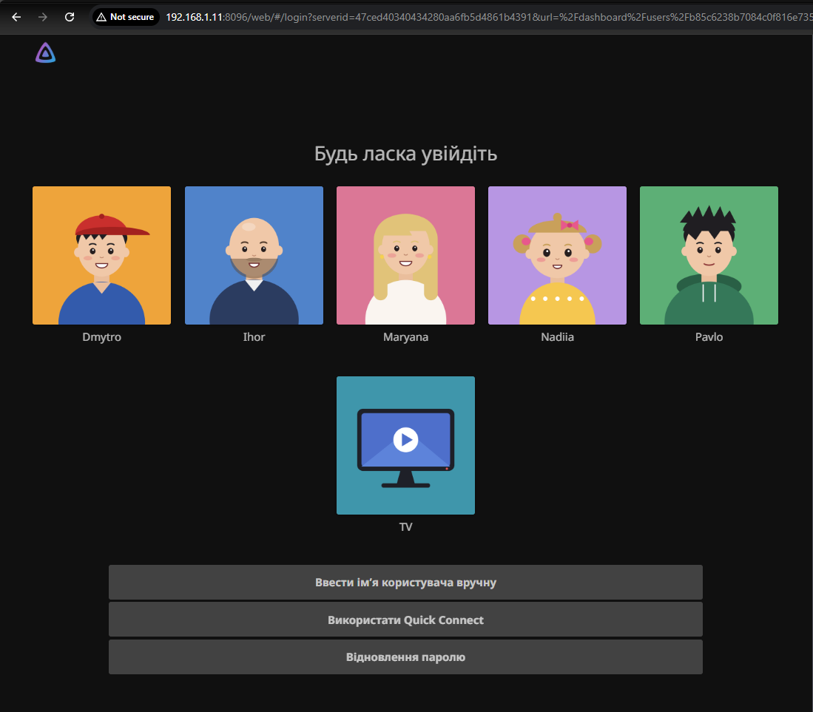
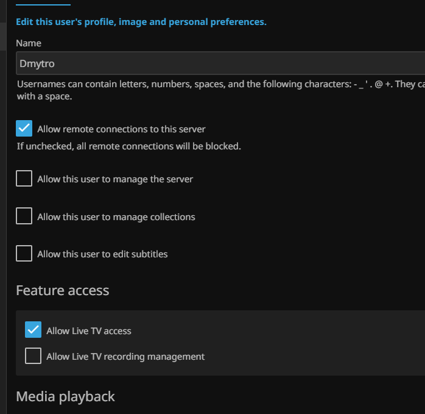
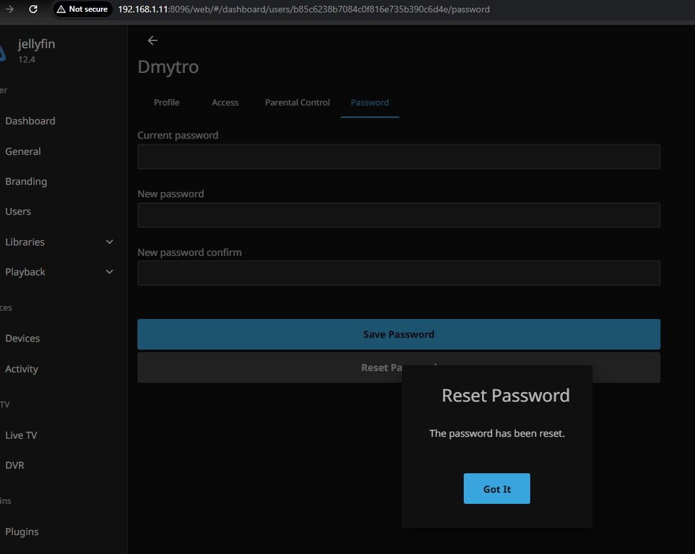
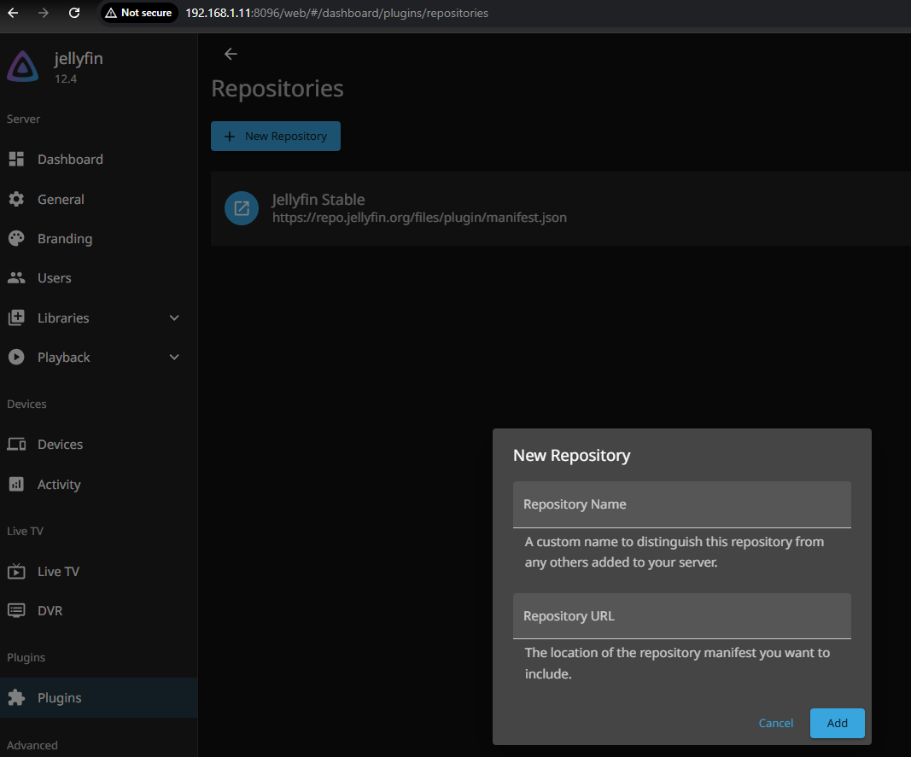
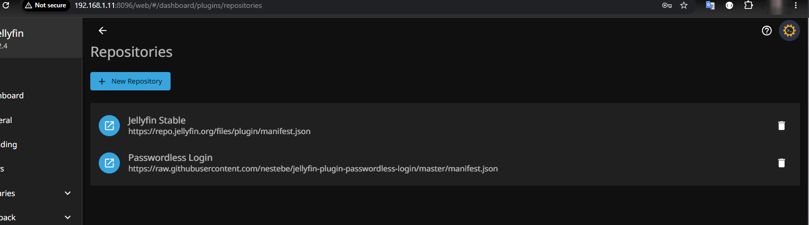
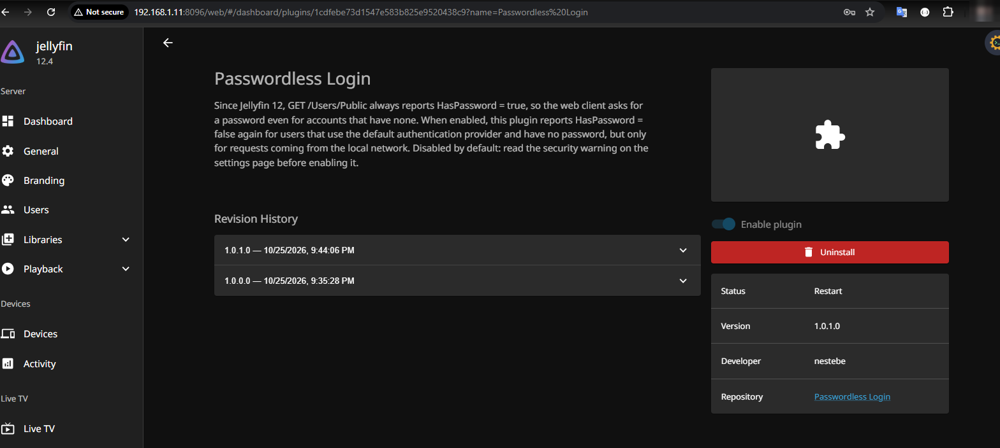

# Jellyfin — settings, users and plugins

**English** | [Українська](README.uk.md) · [← Back to main docs](../README.md)

Jellyfin runs in **LXC 101** at http://192.168.1.11:8096 (version 12.4). This page covers the main server settings, the family user setup, and the installed plugins.

## 1. Main settings

| Area | Where | Value |
|---|---|---|
| Libraries | Dashboard → Libraries | **Movies** → `/media/movies`, **Shows** → `/media/tv` |
| Library monitoring | Library → Manage → *Enable real-time monitoring* | on, plus a scheduled scan |
| Hardware acceleration | Dashboard → Playback → Transcoding | **Intel Quick Sync (QSV)** |
| Hardware decoding | same page | **H.264** and **HEVC (8-bit)** only (Skylake iGPU limit) |
| Quick Connect | Dashboard → General | enabled (log in on the TV with a code from your phone) |

Folder naming that Jellyfin recognises:

```
movies/Movie Name (Year)/Movie Name (Year).mkv
tv/Show Name (Year)/Season 01/Show Name S01E01.mkv
```

> 📷 **Screenshot:** `screenshots/libraries.png` — Dashboard → Libraries
<!--  -->

> 📷 **Screenshot:** `screenshots/transcoding.png` — Playback → Transcoding (QSV)
<!--  -->

## 2. Users

Each family member has their own profile, so watch progress, "Continue watching", favourites and language preferences are tracked separately.

| User | Role | Password | On login screen |
|---|---|---|---|
| root | administrator | yes | hidden |
| Ihor, Maryana | adults | none | yes |
| Pavlo, Dmytro, Nadiia | kids | none | yes |
| TV | shared viewing on the TV | none | yes |

The avatars are in [`users/`](users): flat cartoon pictures, 512×512 px.



### Creating a user
1. **Dashboard → Users → +**: enter the name, leave the password empty, and choose the libraries.
2. On the user's **Profile** tab:
   - **Allow this user to manage the server**: off (on only for root).
   - **Manage collections / Edit subtitles**: off for the kids.
   - **Allow remote connections**: no effect for now (the server is reachable only on the LAN).
3. To hide a user from the tiles (root), tick **Hide this user from login screens**.
4. To set an avatar: click the image at the top of **Profile** and choose the file from `users/`.



### Removing a password
**Users → user → Password → Reset Password**. The "Current password" field may still be shown afterwards, so check by logging in from the tile.



### Parental control and language
- **Parental Control → Maximum allowed parental rating**: for example Nadiia `G / TV-Y`, Dmytro `PG`, Pavlo `PG-13`. Tick *Block items with no rating* for the youngest, otherwise unrated titles stay visible.
- **Avatar → Playback** (set separately in each profile):
  - *Preferred audio language* = Ukrainian;
  - turn off *Play default audio track regardless of language*;
  - subtitles: *Smart* for adults, *Only Forced* for kids.

> 📷 **Screenshot:** `screenshots/parental-control.png` — Parental Control tab
<!--  -->

### Limitations
- Users can always change their own avatar. There is no setting to forbid this; re-upload the file from `users/` if needed.
- Tile order is alphabetical and cannot be changed.
- The mobile app shows the server selection screen after *Sign out*. Tap the server to get to the tiles.

## 3. Plugins

### Passwordless Login (third-party)
Since Jellyfin 12.0, the server always reports that a user has a password. As a result, tapping a tile opens a password form even for accounts without one (upstream: jellyfin/jellyfin#18175, closed as "won't fix"). The plugin [nestebe/jellyfin-plugin-passwordless-login](https://github.com/nestebe/jellyfin-plugin-passwordless-login) restores one-tap login for passwordless users, **only on the local network**.

Installation:
1. Back up the container first: `vzdump 101 --storage nvme-backup --mode snapshot --compress zstd`.
2. **Dashboard → Plugins → Repositories → New Repository**:
   - name `Passwordless Login`;
   - URL `https://raw.githubusercontent.com/nestebe/jellyfin-plugin-passwordless-login/master/manifest.json`.
3. **Catalog → Passwordless Login → Install**, then restart Jellyfin: `pct exec 101 -- systemctl restart jellyfin`.
4. In the plugin settings, tick **Enable one-click login for passwordless users on the local network**.





**Risks:**
- Anyone on the home network, including guests on Wi‑Fi, can open passwordless profiles.
- This is a small community plugin (v1.0.1.0) and may break after Jellyfin updates. If it does, uninstall it or restore the CT 101 backup.

## Changelog

| Date | Change |
|---|---|
| 2026-11-15 | Jellyfin page created: settings, users, Passwordless Login plugin |
