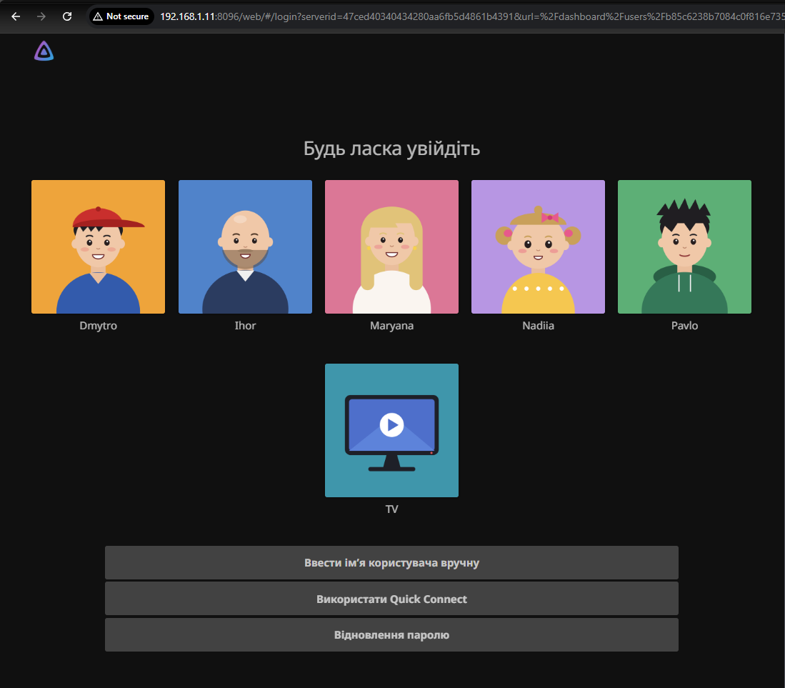
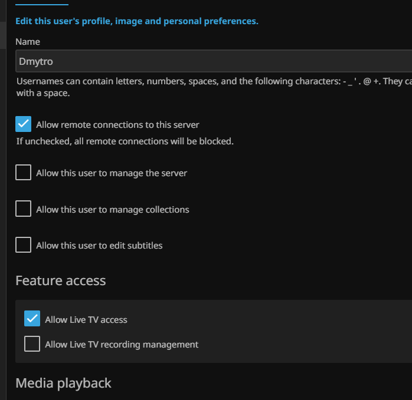
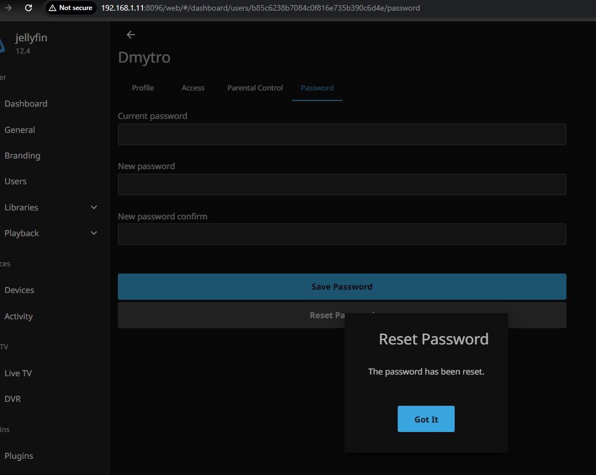
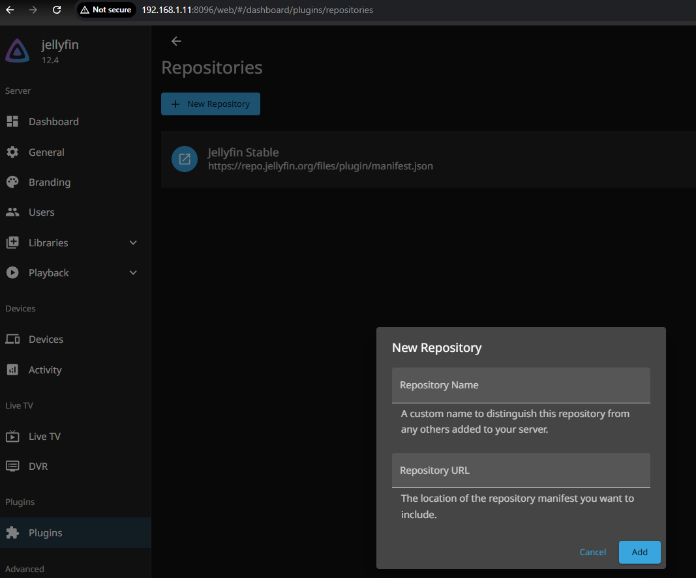
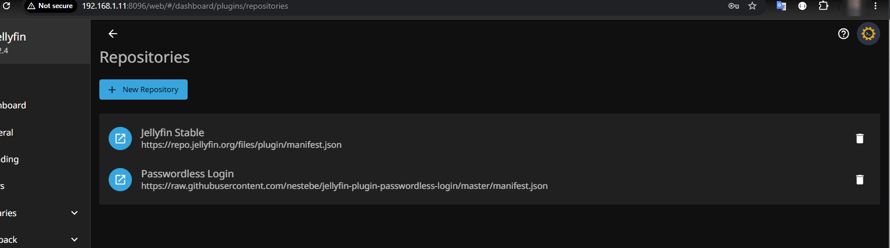
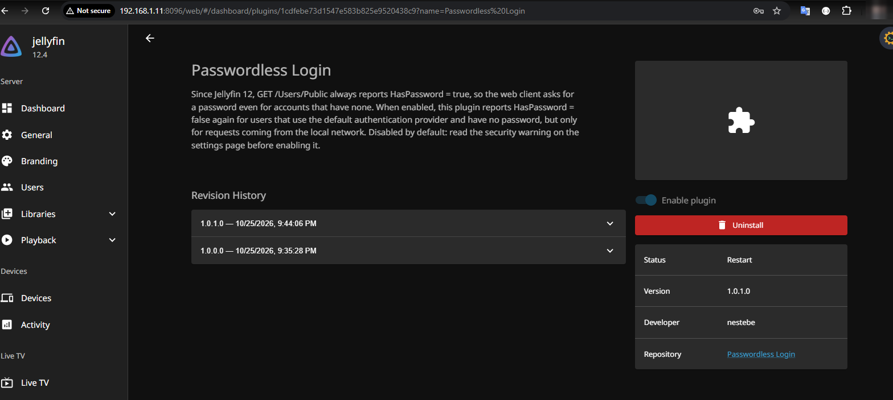

# Jellyfin — налаштування, користувачі та плагіни

[English](README.md) | **Українська** · [← До основної документації](../README.uk.md)

Jellyfin працює в **LXC 101** за адресою http://192.168.1.11:8096 (версія 12.4). На цій сторінці описано основні налаштування сервера, сімейних користувачів і встановлені плагіни.

## 1. Основні налаштування

| Що | Де | Значення |
|---|---|---|
| Бібліотеки | Dashboard → Libraries | **Movies** → `/media/movies`, **Shows** → `/media/tv` |
| Відстеження змін | бібліотека → Manage → *Enable real-time monitoring* | увімкнено, плюс сканування за розкладом |
| Апаратне прискорення | Dashboard → Playback → Transcoding | **Intel Quick Sync (QSV)** |
| Апаратне декодування | там само | лише **H.264** і **HEVC (8-bit)** — обмеження iGPU Skylake |
| Quick Connect | Dashboard → General | увімкнено: вхід на ТВ за кодом з телефона |

Jellyfin розпізнає таку структуру папок:

```
movies/Назва фільму (Рік)/Назва фільму (Рік).mkv
tv/Назва серіалу (Рік)/Season 01/Назва серіалу S01E01.mkv
```

> 📷 **Скріншот:** `screenshots/libraries.png` — Dashboard → Libraries
<!--  -->

> 📷 **Скріншот:** `screenshots/transcoding.png` — Playback → Transcoding (QSV)
<!--  -->

## 2. Користувачі

Кожен член родини має власний профіль. Прогрес перегляду, «Продовжити перегляд», обране і мовні налаштування в кожного свої.

| Користувач | Роль | Пароль | На екрані входу |
|---|---|---|---|
| root | адміністратор | є | прихований |
| Ihor, Maryana | дорослі | немає | так |
| Pavlo, Dmytro, Nadiia | діти | немає | так |
| TV | спільний перегляд на ТВ | немає | так |

Аватари лежать у папці [`users/`](users): пласкі мультяшні зображення 512×512 px.



### Як створити користувача
1. **Dashboard → Users → +**: введіть ім'я, пароль залиште порожнім, виберіть бібліотеки.
2. На вкладці **Profile** цього користувача:
   - **Allow this user to manage the server** — вимкнено (увімкнено лише для root);
   - **Manage collections / Edit subtitles** — для дітей вимкнено;
   - **Allow remote connections** — поки ні на що не впливає, бо сервер доступний лише вдома.
3. Щоб сховати користувача з екрана входу (як root), позначте **Hide this user from login screens**.
4. Щоб поставити аватар, клацніть на зображення вгорі **Profile** і виберіть файл з `users/`.



### Як прибрати пароль
**Users → користувач → Password → Reset Password**. Поле «Current password» після цього може не зникнути, тому перевіряйте входом через плитку.



### Батьківський контроль і мова
- **Parental Control → Maximum allowed parental rating**: наприклад, Nadiia `G / TV-Y`, Dmytro `PG`, Pavlo `PG-13`. Для наймолодших позначте *Block items with no rating*, бо інакше фільми без рейтингу лишаться видимими.
- **Аватар → Playback**, у кожному профілі окремо:
  - *Preferred audio language* — Ukrainian;
  - *Play default audio track regardless of language* — вимкнути;
  - субтитри: *Smart* для дорослих, *Only Forced* для дітей.

> 📷 **Скріншот:** `screenshots/parental-control.png` — вкладка Parental Control
<!--  -->

### Обмеження
- Користувач завжди може змінити свій аватар, заборонити це не можна. За потреби завантажте файл з `users/` повторно.
- Порядок плиток іде за алфавітом і не налаштовується.
- Мобільний застосунок після *Sign out* показує вибір сервера: натисніть на сервер, щоб побачити плитки.

## 3. Плагіни

### Passwordless Login (сторонній)
Починаючи з Jellyfin 12.0, сервер завжди повідомляє, що в користувача є пароль. Через це при натисканні на плитку відкривається форма пароля навіть для акаунтів без пароля (jellyfin/jellyfin#18175, закрито як «won't fix»). Плагін [nestebe/jellyfin-plugin-passwordless-login](https://github.com/nestebe/jellyfin-plugin-passwordless-login) повертає вхід в один дотик для користувачів без пароля, **лише в локальній мережі**.

Встановлення:
1. Спершу зробіть бекап контейнера: `vzdump 101 --storage nvme-backup --mode snapshot --compress zstd`.
2. **Dashboard → Plugins → Repositories → New Repository**:
   - назва `Passwordless Login`;
   - URL `https://raw.githubusercontent.com/nestebe/jellyfin-plugin-passwordless-login/master/manifest.json`.
3. **Catalog → Passwordless Login → Install**, потім перезапустіть Jellyfin: `pct exec 101 -- systemctl restart jellyfin`.
4. У налаштуваннях плагіна позначте **Enable one-click login for passwordless users on the local network**.





**Ризики:**
- Будь-хто в домашній мережі, зокрема гості на Wi‑Fi, може відкрити профілі без пароля.
- Це невеликий плагін від спільноти (v1.0.1.0), тож після оновлень Jellyfin він може зламатися. У такому разі видаліть його або відновіть CT 101 з бекапу.

## Історія змін

| Дата | Зміна |
|---|---|
| 2026-11-15 | Створено сторінку Jellyfin: налаштування, користувачі, плагін Passwordless Login |
