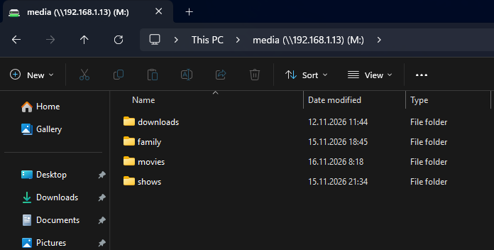
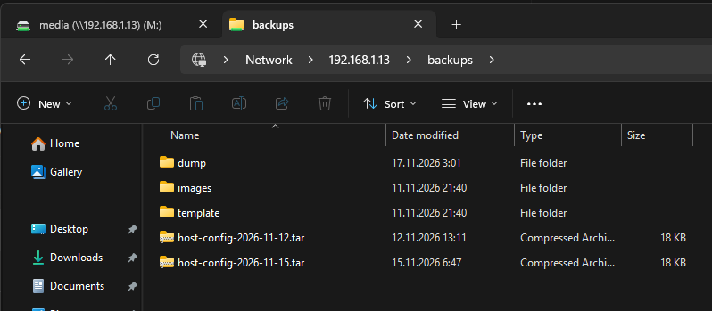
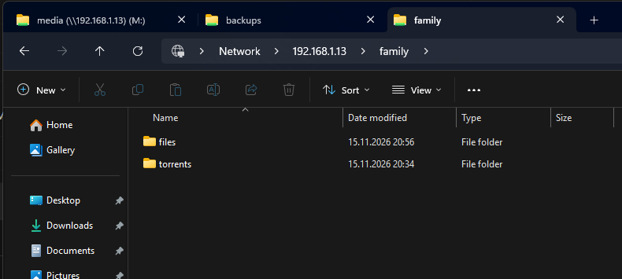
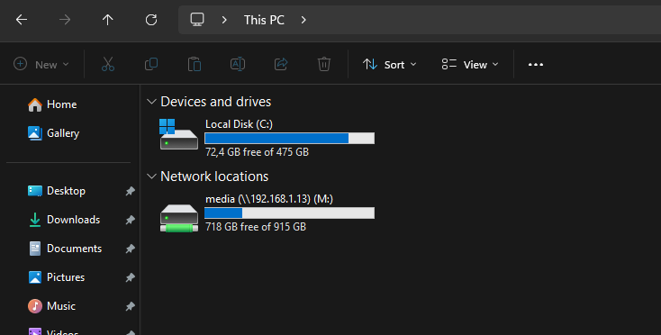

# Samba — shares, users and folder structure

**English** | [Українська](README.uk.md) · [← Back to main docs](../README.md)

Samba runs in **LXC 103** (Debian 13) at `\\192.168.1.13`. It is the file server for the whole family: the admin gets the full media tree and the backups, and family members get a separate shared folder plus a drop box for torrents.

## 1. Folder structure

All data lives on the NVMe disk of the Proxmox host and is passed into the containers with bind mounts.

```
/mnt/nvme-pool/
├── media/                      → /media in CT 101, 102, 103      [media]
│   ├── movies/                 Jellyfin "Movies" library
│   ├── shows/                  Jellyfin "Shows" library
│   ├── downloads/
│   │   ├── incomplete/         qBittorrent: files being downloaded
│   │   └── complete/           qBittorrent: default save path
│   └── family/                                                   [family]
│       ├── files/              shared family files
│       └── torrents/
│           ├── movies/         drop .torrent here → /media/movies
│           └── shows/          drop .torrent here → /media/shows
└── backups/                    → /backups (read-only) in CT 103  [backups]
    ├── dump/                   vzdump archives of all VMs/CTs
    ├── images/  template/      created by Proxmox, unused
    └── host-config-*.tar.gz    weekly host configuration archive
```

Bind mounts of CT 103:

```
mp0: /mnt/nvme-pool/media,mp=/media
mp1: /mnt/nvme-pool/backups,mp=/backups,ro=1
```

`family/` sits inside `media/`, so it needs no separate mount point. The admin also sees it as `M:\family`.



## 2. Shares

| Share | Path in CT | Access | Users |
|---|---|---|---|
| `[media]` | `/media` | read/write | `media` (admin) |
| `[backups]` | `/backups` | read-only | `media` (admin) |
| `[family]` | `/media/family` | read/write | `family`, `media` |

### [media]
The whole media tree: films, shows, downloads and the family folder. Only the admin user `media` can open it. Use it to manage the libraries: rename files, move them, delete them.

```ini
[media]
   path = /media
   writable = yes
   valid users = media
   force user = media
   force group = media
   create mask = 0664
   directory mask = 0775
```

### [backups]
The Proxmox backups, read-only. Use it to copy archives to an external disk. The mount is read-only twice: in Samba (`read only = yes`) and in Proxmox (`ro=1`), so nothing can be deleted over the network.



```ini
[backups]
   path = /backups
   read only = yes
   valid users = media
```

### [family]
The family share. The `family` user sees only this share and cannot open `[media]` or `[backups]`.
- `files/` — any shared files: documents, photos to pass around, installers.
- `torrents/movies/` and `torrents/shows/` — a drop box. qBittorrent watches these folders: a dropped `.torrent` is added automatically, the download goes to the Jellyfin library, and the `.torrent` file is deleted at once. Family members do not need the qBittorrent Web UI.



```ini
[family]
   path = /media/family
   writable = yes
   valid users = family media
   force user = media
   force group = media
   create mask = 0664
   directory mask = 0775
```

### Global settings

| Setting | Why |
|---|---|
| `map to guest = never`, `restrict anonymous = 2` | no guest or anonymous access |
| `server min protocol = SMB2_10` | SMB1 is off |
| `disable netbios = yes`, `smb ports = 445` | modern SMB over port 445 only; connect by IP |
| `veto files = /._*/.DS_Store/` | hide macOS junk files |
| `use sendfile = yes` | faster reads of large files |

## 3. Users and permissions

| Samba user | Linux account in CT 103 | Shares |
|---|---|---|
| `media` | uid 1000 (host uid 101000) | `[media]`, `[backups]`, `[family]` |
| `family` | system account without login (`/usr/sbin/nologin`) | `[family]` |

All shares use `force user = media`. Whoever connects, files are written as `media` with mode `664/775`, so Jellyfin and qBittorrent can always read and change them.

Adding a Samba user (run on the Proxmox host; the user types the password):

```bash
pct exec 103 -- useradd -M -s /usr/sbin/nologin <name>
pct exec 103 -- smbpasswd -a <name>
```

Then add the name to `valid users` of the needed share and apply the change:

```bash
pct exec 103 -- testparm -s
pct exec 103 -- systemctl reload smbd
```

## 4. Connecting

| Device | Address | User |
|---|---|---|
| Admin PC (Windows) | `M:` → `\\192.168.1.13\media` | `192.168.1.13\media` |
| Admin PC, backups (optional) | `B:` → `\\192.168.1.13\backups` | `192.168.1.13\media` |
| Family devices (Windows) | `\\192.168.1.13\family` | `192.168.1.13\family` |
| Phones, Mac | `smb://192.168.1.13/family` | `family` |

Map a drive from PowerShell **without** admin rights, otherwise Explorer does not show it:

```powershell
net use M: \\192.168.1.13\media /persistent:yes
```



## 5. Limitations

- **Not visible in Network.** NetBIOS is off and `wsdd` is not packaged for Debian 13, so Windows does not discover the server by itself. Always type the IP.
- **One user per server on Windows.** Windows cannot connect to the same server as two different users at once (error 1219). On the admin PC the `family` folder is reachable through `M:\family`; test the `family` login from another device.
- **Explorer shows stale folders.** A `.torrent` deleted by qBittorrent can stay visible for a while. Press **F5**.
- **LAN only.** Samba must never be exposed to the internet. Remote access is planned through a VPN (see the roadmap in the main docs).

## Changelog

| Date | Change |
|---|---|
| 2026-11-16 | Samba page created: shares, folder structure, users, connecting |
