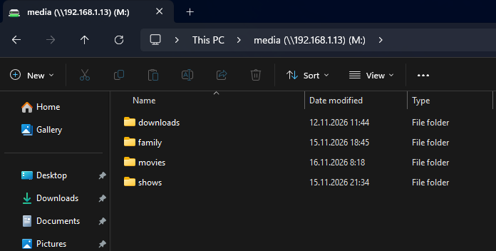
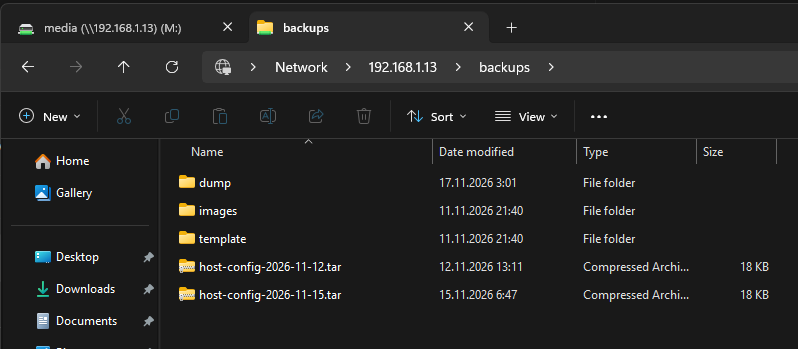
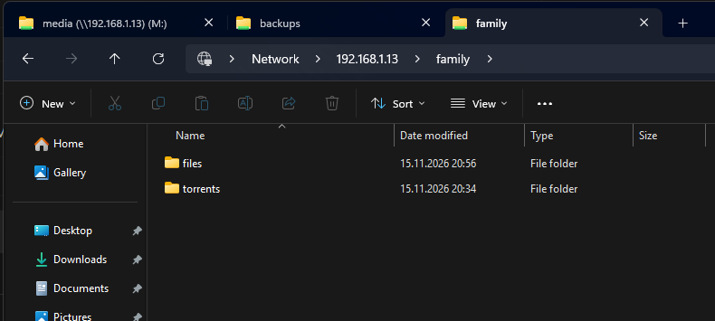
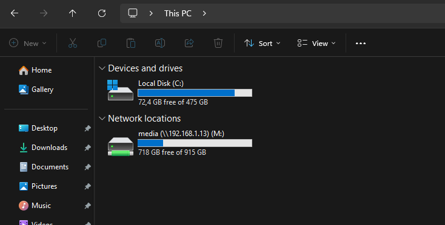

# Samba — ресурси, користувачі та структура папок

[English](README.md) | **Українська** · [← До основної документації](../README.uk.md)

Samba працює в **LXC 103** (Debian 13) за адресою `\\192.168.1.13`. Це файловий сервер для всієї родини. Адміністратор має доступ до всієї медіатеки і бекапів, а члени родини — до окремої спільної папки та скриньки для торентів.

## 1. Структура папок

Усі дані лежать на NVMe-диску хоста Proxmox і передаються в контейнери через bind mount.

```
/mnt/nvme-pool/
├── media/                      → /media у CT 101, 102, 103       [media]
│   ├── movies/                 бібліотека Jellyfin «Movies»
│   ├── shows/                  бібліотека Jellyfin «Shows»
│   ├── downloads/
│   │   ├── incomplete/         qBittorrent: файли, що завантажуються
│   │   └── complete/           qBittorrent: шлях збереження за замовчуванням
│   └── family/                                                   [family]
│       ├── files/              спільні файли родини
│       └── torrents/
│           ├── movies/         покладіть .torrent → /media/movies
│           └── shows/          покладіть .torrent → /media/shows
└── backups/                    → /backups (лише читання) у CT 103 [backups]
    ├── dump/                   архіви vzdump усіх VM/CT
    ├── images/  template/      створені Proxmox, не використовуються
    └── host-config-*.tar.gz    щотижневий архів конфігурації хоста
```

Bind mount у CT 103:

```
mp0: /mnt/nvme-pool/media,mp=/media
mp1: /mnt/nvme-pool/backups,mp=/backups,ro=1
```

`family/` лежить усередині `media/`, тому окрема точка монтування не потрібна. Адміністратор бачить цю папку і як `M:\family`.



## 2. Ресурси

| Ресурс | Шлях у CT | Доступ | Користувачі |
|---|---|---|---|
| `[media]` | `/media` | читання і запис | `media` (адмін) |
| `[backups]` | `/backups` | лише читання | `media` (адмін) |
| `[family]` | `/media/family` | читання і запис | `family`, `media` |

### [media]
Уся медіатека: фільми, серіали, завантаження і папка родини. Відкрити її може лише адміністратор `media`. Через цей ресурс керують бібліотеками: перейменовують, переносять і видаляють файли.

```ini
[media]
   path = /media
   writable = yes
   valid users = media
   force user = media
   force group = media
   create mask = 0664
   directory mask = 0775
```

### [backups]
Бекапи Proxmox, лише для читання. Через цей ресурс зручно копіювати архіви на зовнішній диск. Доступ обмежено двічі: у Samba (`read only = yes`) і в Proxmox (`ro=1`), тож через мережу нічого не можна видалити.



```ini
[backups]
   path = /backups
   read only = yes
   valid users = media
```

### [family]
Спільний ресурс для родини. Користувач `family` бачить лише його і не може відкрити `[media]` чи `[backups]`.
- `files/` — будь-які спільні файли: документи, фото, щоб передати іншим, інсталятори.
- `torrents/movies/` і `torrents/shows/` — скринька для торентів. qBittorrent стежить за цими папками: покладений `.torrent` додається автоматично, завантаження йде в бібліотеку Jellyfin, а сам `.torrent` одразу видаляється. Членам родини вебінтерфейс qBittorrent не потрібен.



```ini
[family]
   path = /media/family
   writable = yes
   valid users = family media
   force user = media
   force group = media
   create mask = 0664
   directory mask = 0775
```

### Глобальні налаштування

| Параметр | Навіщо |
|---|---|
| `map to guest = never`, `restrict anonymous = 2` | без гостьового й анонімного доступу |
| `server min protocol = SMB2_10` | SMB1 вимкнено |
| `disable netbios = yes`, `smb ports = 445` | лише сучасний SMB на порту 445; підключення за IP |
| `veto files = /._*/.DS_Store/` | приховати службові файли macOS |
| `use sendfile = yes` | швидше читання великих файлів |

## 3. Користувачі та права

| Користувач Samba | Обліковий запис Linux у CT 103 | Ресурси |
|---|---|---|
| `media` | uid 1000 (на хості uid 101000) | `[media]`, `[backups]`, `[family]` |
| `family` | системний, без входу (`/usr/sbin/nologin`) | `[family]` |

Усі ресурси мають `force user = media`. Хто б не підключився, файли записуються від імені `media` з правами `664/775`, тому Jellyfin і qBittorrent завжди можуть їх читати і змінювати.

Як додати користувача Samba (виконати на хості Proxmox; пароль користувач вводить сам):

```bash
pct exec 103 -- useradd -M -s /usr/sbin/nologin <ім'я>
pct exec 103 -- smbpasswd -a <ім'я>
```

Потім додайте ім'я у `valid users` потрібного ресурсу і застосуйте зміни:

```bash
pct exec 103 -- testparm -s
pct exec 103 -- systemctl reload smbd
```

## 4. Підключення

| Пристрій | Адреса | Користувач |
|---|---|---|
| ПК адміністратора (Windows) | `M:` → `\\192.168.1.13\media` | `192.168.1.13\media` |
| ПК адміністратора, бекапи (за бажанням) | `B:` → `\\192.168.1.13\backups` | `192.168.1.13\media` |
| Пристрої родини (Windows) | `\\192.168.1.13\family` | `192.168.1.13\family` |
| Телефони, Mac | `smb://192.168.1.13/family` | `family` |

Диск підключайте з PowerShell **без** прав адміністратора, інакше Explorer його не побачить:

```powershell
net use M: \\192.168.1.13\media /persistent:yes
```



## 5. Обмеження

- **Сервер не видно в «Мережі».** NetBIOS вимкнено, а пакета `wsdd` для Debian 13 немає, тож Windows сама сервер не знайде. Завжди вводьте IP.
- **Один користувач на сервер у Windows.** Windows не може підключитися до одного сервера під двома різними користувачами одночасно (помилка 1219). На ПК адміністратора папка `family` доступна через `M:\family`, а вхід під `family` перевіряйте з іншого пристрою.
- **Explorer показує застарілий вміст.** Видалений qBittorrent `.torrent` може ще деякий час відображатися. Натисніть **F5**.
- **Лише локальна мережа.** Samba не можна відкривати в інтернет. Віддалений доступ планується через VPN (див. план розвитку в основній документації).

## Історія змін

| Дата | Зміна |
|---|---|
| 2026-11-16 | Створено сторінку Samba: ресурси, структура папок, користувачі, підключення |
